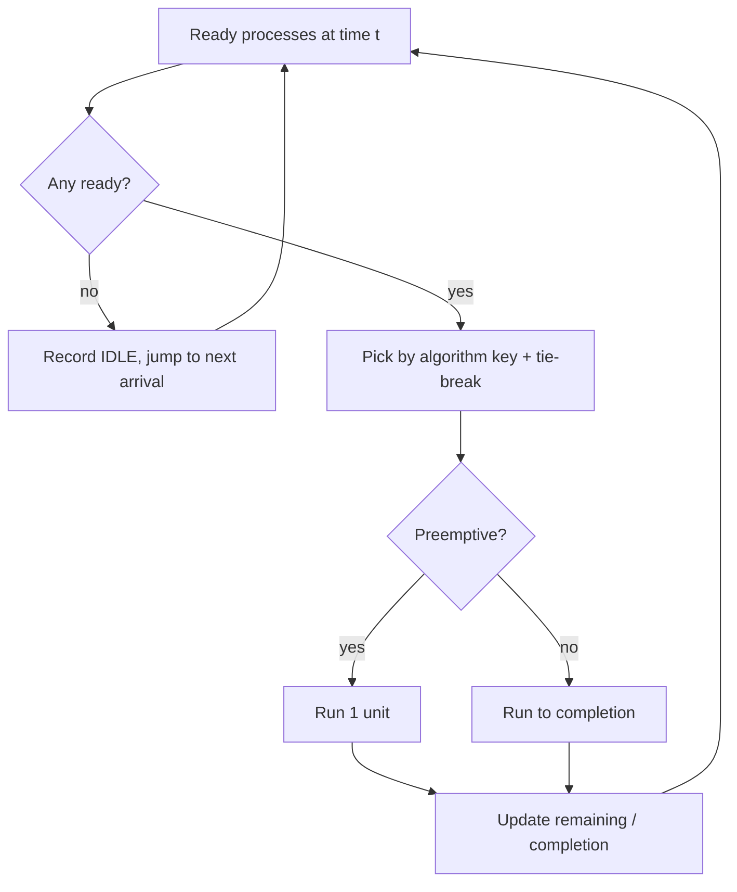

# Algorithms

All programs read one JSON object on stdin and write one JSON object on stdout (`{"error": "..."}` and exit code 2 on invalid input). Source: `backend/*.cpp`, shared code in `backend/include/`.

## Conventions
- Time is in integer simulated minutes. Arrival >= 0, burst >= 1 (integers only).
- **Priority: smaller number = more urgent** (1 is highest).
- **Tie-break (all algorithms):** earlier arrival, then earlier position in the input list. Results are deterministic.
- Idle time appears in the Gantt chart as `IDLE`.
- `Turnaround = Completion - Arrival`, `Waiting = Turnaround - Burst`, `Response = Start - Arrival` (first time on the resource). For non-preemptive algorithms Response = Waiting.

| Module | Program | Algorithms |
|---|---|---|
| Runway | `runway_scheduler` | FCFS, PRIORITY_NP (non-preemptive) |
| Baggage | `baggage_scheduler` | SRTF, PRIORITY_P (preemptive) |
| Maintenance | `maintenance_scheduler` | PRIORITY_P, RR (quantum 1..1000) |

## Scheduling simulation (`include/scheduler.h`)
```text
t = 0
while unfinished processes remain:
    FCFS / SRTF / PRIORITY: pick ready process with the smallest (key, arrival, index)
        key = arrival (FCFS) | remaining time (SRTF) | priority
    if none ready: add IDLE until the next arrival
    non-preemptive: run to completion;  preemptive: run 1 time unit then re-decide
    RR: take queue front, run min(quantum, remaining); processes that arrived during the slice
        are queued BEFORE the preempted process is appended
```
Consecutive slices of the same process are merged, so a preempted process appears as separate Gantt intervals. Complexity: O(T * n) for tick-based preemptive selection (T = total time), O(n^2) non-preemptive, O(T/q + n log n) for Round Robin.



## Banker's algorithm (`bankers_algorithm.cpp`)
State: Available (m), Allocation (n x m), Max (n x m), `Need = Max - Allocation`.

**Safety algorithm** (pass-based scan in process order): `Work = Available`; repeat passes: for each unfinished `i` with `Need[i] <= Work`: `Work += Allocation[i]`, mark finished, append to sequence. Safe iff all finish. Complexity O(n^2 m).

**Request algorithm** for process `i` with `Request`:
1. Validate (known process, vector length, non-negative, not all zero) otherwise `INVALID`.
2. `Request <= Need[i]` else `DENIED_EXCEEDS_MAX`.
3. `Request <= Available` else `DENIED_EXCEEDS_AVAILABLE` (process waits).
4. Tentatively: `Available -= Request; Allocation[i] += Request; Need[i] -= Request`.
5. Run safety. Safe: `GRANTED` (with sequence). Unsafe: `DENIED_UNSAFE` and the tentative change is discarded (rollback).

An **unsafe state is not a deadlock**: it only means deadlock is possible. The Node layer commits a `GRANTED` result to MySQL; the C++ program never touches the database.

## Deadlock detection (`deadlock_detection.cpp`)
Inputs: Available, Allocation, outstanding Request matrix. `Work = Available`; `Finish[i] = true` if process `i` holds nothing. Repeat: find unfinished `i` with `Request[i] <= Work`; `Work += Allocation[i]`; `Finish[i] = true`. Unfinished processes at the end are deadlocked.

Results: `NO_DEADLOCK`, `DEADLOCK`, `INVALID_STATE` (bad shapes/negative values), `INSUFFICIENT_INFORMATION` (missing data, no processes or no resource types). Complexity O(n^2 m).

## Concurrency (Node + MySQL)
Every request/release/terminate: `BEGIN` -> `SELECT ... FROM resource_types ORDER BY resource_id FOR UPDATE` (all rows, always in the same order, so no lock cycles) -> read snapshot -> run C++ -> write allocations and counters + audit log -> `COMMIT`. A guarded `UPDATE ... WHERE available_instances >= ?` and a `CHECK` constraint are additional safety nets.
