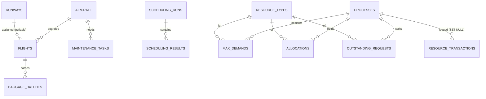

# Database Design (MySQL 8.x, InnoDB, utf8mb4)

Scripts: `database/schema.sql` (structure), `seed.sql` (demo data = scenario 1), `deadlock_demo.sql` (scenario 4 as SQL).

| Table | Purpose / key constraints |
|---|---|
| `runways` | PK `runway_id`; UNIQUE name; CHECK length 500-6000 |
| `aircraft` | PK; UNIQUE registration; status ENUM |
| `flights` | FK aircraft (RESTRICT), FK runway (SET NULL); UNIQUE flight_number; CHECK arrival >= 0, burst >= 1, priority 1-99 |
| `baggage_batches` | FK flight (CASCADE); same CHECKs |
| `maintenance_tasks` | FK aircraft (RESTRICT); status PENDING/COMPLETED |
| `scheduling_runs` / `scheduling_results` | One run (metrics + Gantt JSON), many result rows (FK CASCADE) |
| `resource_types` | `available_instances` is a **STORED generated column** = total - allocated; CHECK `0 <= allocated <= total` |
| `processes`, `max_demands`, `allocations`, `outstanding_requests` | Composite PK (process, resource); CHECK units >= 0; FK CASCADE |
| `deadlock_checks` | Result ENUM + JSON lists of finishable/unfinished processes |
| `resource_transactions` | Audit log (REQUEST/RELEASE/TERMINATE/DEMO_INIT); process FK SET NULL, name kept |

## Normalization
- 1NF: atomic columns; JSON is used only for stored output snapshots (Gantt, audit quantities), not for queried facts.
- 2NF/3NF: matrices are stored as rows `(process, resource, value)` instead of repeated columns, so adding a resource type needs no schema change; descriptive data (aircraft model, runway length) lives once in its own table.
- Derived data (`available_instances`) is generated by the database so it cannot drift.

## Integrity and safe deletes
Aircraft with flights/tasks cannot be deleted (RESTRICT); deleting a flight removes its baggage batches; a resource type with allocated units or a process still holding resources cannot be deleted through the API. All queries use bound parameters; table/column names come from server-side configuration only.

## Consistency of the allocation counter
`resource_types.allocated_instances` must equal the sum of `allocations.units` for that resource. The API checks this on every snapshot and returns 409 if they differ.
