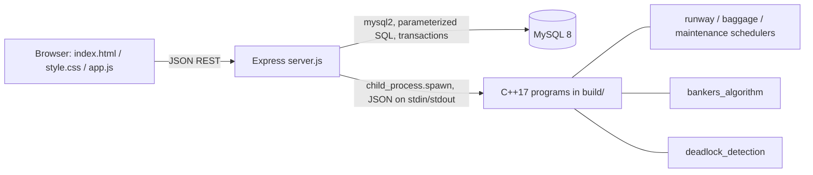

# Project Report: Airport Runway Management System

## Abstract
The project maps airport operations onto classic Operating Systems problems. Runways, baggage lines and maintenance crews are the "CPU"; flights, baggage batches and maintenance tasks are "processes"; maintenance bays, diagnostic equipment, baggage stations and ground-support equipment are resource types. Scheduling, Banker's algorithm and deadlock detection are implemented in C++17, orchestrated by Node.js/Express, persisted in MySQL and presented in a three-file vanilla-JavaScript dashboard.

## Objectives
1. Implement FCFS, non-preemptive Priority, SRTF, preemptive Priority and Round Robin and compare their metrics.
2. Implement Banker's algorithm (avoidance) and multiple-instance deadlock detection as separate algorithms.
3. Keep MySQL as the single authoritative store, with transactions and row locking for resource changes.
4. Provide a complete, testable, explainable system suitable for a B.Tech viva.

## Architecture

Design decisions:
- C++ programs are **pure functions** (JSON in, JSON out). They never access the database, so they are easy to test.
- Node validates input, takes the DB lock, builds a consistent snapshot, calls the C++ program, then commits or rolls back. The browser never decides an allocation.
- Only a fixed allow-list of executable names can run (`backend/lib/cpp.js`); no shell is used; there is a 5 s timeout and an output-size cap.

## Modules
| Module | Algorithms | Notes |
|---|---|---|
| A Runway | FCFS, Priority (non-preemptive) | runs on stored `flights` |
| B Baggage | SRTF, Priority (preemptive) | runs on stored `baggage_batches` |
| C Maintenance | Priority (preemptive), Round Robin | runs on `PENDING` tasks; academic simulation only |
| D Resources | Banker's, deadlock detection, release, terminate (confirmed), 6 demo scenarios | state in MySQL |

Urgent maintenance tasks get a smaller priority number, so preemptive priority scheduling interrupts less urgent work and resumes it afterwards with its remaining time preserved. This is a CPU-scheduling model, not guidance for real maintenance.

## API summary (all under `/api`, JSON `{ok, data}` or `{ok:false, error:{code,message}}`)
| Area | Endpoints |
|---|---|
| Health, stats | `GET /health`, `GET /dashboard`, `GET /reports` |
| CRUD | `/aircraft`, `/flights`, `/runways`, `/baggage-batches`, `/maintenance-tasks` (GET, GET /:id, POST, PUT /:id, DELETE /:id) |
| Scheduling | `POST /schedule/{runway,baggage,maintenance}`, `GET /runs`, `GET/DELETE /runs/:id` |
| Resources | `/resources` (CRUD), `/processes` (CRUD), `GET /state`, `POST /resources/request`, `POST /resources/release`, `POST /processes/:id/terminate` (needs `confirm:true`), `POST /bankers/safety`, `POST /deadlock/detect`, `GET /deadlock/checks`, `GET /transactions` |
| Demo | `GET /demo/scenarios`, `POST /demo/init {scenario:1-6}`, `POST /demo/reset` |

## Demo scenarios
1 safe state, 2 request exceeds Available, 3 request leads to unsafe state, 4 genuine deadlock, 5 release resolves the deadlock, 6 request exceeds declared maximum. Definitions: `backend/lib/scenarios.js`.

## Results
All 32 automated tests pass in the development environment (see `TESTING.md`). Banker's output matches the textbook example (safe sequence P1, P3, P4, P0, P2) and the textbook unsafe request; the SRTF/RR/priority traces were verified by hand. 18 concurrent resource requests never allocated more than the free instances.

## Limitations
- Time is discrete (integer minutes); one resource per scheduling run; non-integer times are rejected.
- Preemptive algorithms are simulated tick by tick (fine for classroom sizes; capped at 1000 processes and burst <= 1000 in the API).
- Scheduling inputs are the stored records; ad hoc process lists are not exposed through the API (the C++ programs accept them directly).
- Scenario initialisation recreates resource rows, so resource/process IDs change.
- Waiting requests are recorded only when the user ticks "keep as waiting request" (or by scenarios).
- No authentication or user accounts; intended for local use.
- The frontend is deliberately compact (<= 300 lines per file), so it has fewer conveniences (e.g. numeric ID inputs instead of lookup pickers).

## Future scope
Authentication, preemptive multi-runway scheduling, multi-level feedback queues, real-time deadlock monitoring via WebSockets, resource-allocation graph visualisation.
